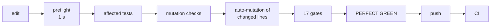

# CleanCore — AI-assisted engineering, held to evidence

**Isaiah · Windows security & maintenance app · Python + a WebView2 UI · GPL-3.0**
Public releases: [github.com/ICCORE/CleanCore](https://github.com/ICCORE/CleanCore) · Source: private, available on request

I design and direct CleanCore, a Windows cleaner and protection app, using an AI coding agent
(Anthropic's Claude) as my engineering partner. My hands limit how much I can type, so I own what the
AI can't: the product, the design calls, and the **rules every line of code has to pass before it
ships**. Those rules are enforced by tools, not trust.

> "I refuse assumptions, I only accept the truth with evidence and proof." — the rule I set on
> 2026-09-11, still the top rule today.

## At a glance (measured 2026-10-31)

| | |
|---|---|
| History in git | 1,135 commits since 2026-08-09 |
| App code | 59 Python modules, 51,219 lines, plus a 3,753-line web UI |
| Tests | 447 test files · 3,568 test functions · 138,265 lines of test code |
| Real bugs kept as permanent checks | 2,795 registered mutations, every one caught by a test |
| Automated gates per commit | 17, plus 24 self-tests proving each gate can still fail |

## What CleanCore is

**The cleaner that isn't junk itself.** No ads, no nags, no bundled offers. Safety and undo are never
behind a paywall. Results are honest ("Nothing to clean" instead of a scary number). And nothing
leaves the user's PC: no account, no telemetry; threat definitions and updates are Ed25519-signed and
checked on the PC; a problem report is shown in full, saved to the Desktop, and only sent if the user
sends it from their own mail app.

## 1 · A governance framework for an AI engineer

An AI agent writes code fast and sounds confident whether or not it's right. My rulebook turns
"trust me" into "show me". Every rule came from a real, logged failure.

- **Evidence over assertion.** The AI may not claim anything it didn't verify in that session. A
  negative ("this never happens") needs the same proof as a positive.
- **The five questions.** Before any fix: WHAT (the user's words + what was measured), WHERE, WHEN,
  WHY (cause with evidence, or "unverified"), HOW (how it's proven, how it could still be wrong). A git
  hook rejects any commit message without them.
- **Red before green.** Every fix needs a test proven to FAIL on the old code.
- **Enforced guardrails.** Commit hooks, a one-second preflight, blocked commands (the agent can't run
  the release build or skip hooks), tests on a hidden desktop against a fake PC — never real data.
- **Perfect green before every push.** One command must report PERFECT GREEN (last CI green, clean
  tree, affected tests, UI tests ×3, wording audit, auto-mutation, full gate run); the commit must be
  exactly the tree that was verified, and a pre-push hook checks it.
- **Scoped autonomy.** One writer at a time, at most one sub-agent, long runs in the background at low
  priority.

## 2 · Tests that prove themselves

Passing tests prove little if the tests are weak, so the pipeline attacks its own tests.

- **2,795 real bugs, kept forever.** Each is a past bug re-inserted as a one-line edit, with the one
  test that must catch it. The exemption list stays empty.
- **Auto-mutation.** Every changed line gets its comparisons and logic flipped; a surviving mutant fails
  the build.
- **Diff coverage under tracing.** Every changed function must be executed by a test.
- **A Simulator.** A seeded fuzzer throws garbage at every UI-to-Python call, and a "monkey" clicks
  through the real page on the fake PC. Its first run found eight real faults, all fixed.
- **Words are audited too.** Every on-screen sentence is inventoried and checked against what the code
  really does; 327 text/background pairs pass 4.5:1 contrast in all 14 colour palettes.

## 3 · Case studies (troubleshooting from evidence)

**DNS Speed: measuring the right thing.** The old check pinged DNS servers, but a ping is not a lookup.
Measured on my PC: Google pinged in 15 ms but took 35 ms to answer a real lookup. It now times real UDP
lookups, and only suggests a switch that is at least 15 ms faster than the server already in use.

**Game Mode and GPU crashes: testing my own hypothesis.** I suspected Game Mode was triggering my
PC's GPU driver crashes. The evidence said no: Windows logged 14 identical crashes, and 5 of them
happened before Game Mode existed in the code; another followed a Game Mode start that changed
nothing. The real change that came out of it: Game Mode no longer raises every game's priority by
default — only games the user chooses.

**Making the checks faster without lowering the bar.** I asked why a full verification took over an
hour. Timers showed the full suite ran twice on identical code (701 s, then 694 s). Now the second
run is reused, but only when a fingerprint of every file a result depends on is byte-identical — with
tests and mutations proving the reuse can't be fooled.

**Prototype, measure, decide: the new UI.** The WebView2 prototype used far more memory than the old
UI. I accepted the trade-off with a hard cap: a test launches the real UI hidden and fails the build
above 170 MB.

## How this maps to applied AI engineering

| The role asks for | What I've done |
|---|---|
| Governance for safe, responsible AI | Wrote and enforced a governance framework for an AI agent: evidence rules, hooks, blocked actions, sandboxed tests, scoped autonomy |
| Evaluating model output | Mutation testing, auto-mutation and diff coverage on AI-written code; a claims audit on AI-written text |
| Optimizing AI workflows | Refined the agent's rules from logged failures; measured and cut repeated verification work |
| Working from evidence | Every claim, fix and performance change backed by a measurement, before and after |

## What's next

The new UI ships once it's exactly as designed. In design: **CORE**, a fully local AI engineering
assistant specialized for CleanCore, scored on a benchmark built from those 2,795 real bugs.
